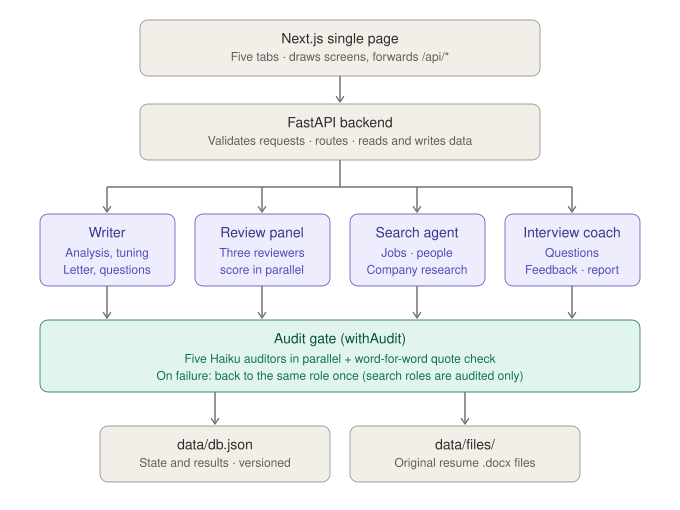

# GoJob

**A local job-search workspace that tells you which jobs are worth applying to, and never invents experience to get you there.**

Runs on your own computer. Your data stays in the `data/` folder.

## One page, five steps

| | Step | You get |
|---|---|---|
| 1 | **Profile** | A health check of your resume against your target job descriptions |
| 2 | **Find jobs** | A region-by-region scan; only openings with a real link |
| 3 | **Target JD** | Match score, tailored resume, cover letter, interview prep, networking plan |
| 4 | **Tracker** | One row per application, ready to paste into your own sheet |
| 5 | **Interview coach** | Practice answers from your story bank, with feedback |

## Why it is different

- **A clear apply decision.** Average 80 or more with no reviewer below 70: apply. 60 to 79: tune first. Below 60: skip. Work-visa wording in the posting is part of the verdict.
- **Honest by design.** Rewrites cannot add numbers, tools or titles. Code checks that every quote appears word for word in your resume or the JD, and five auditors review each answer.
- **It knows when to stop.** Tuning only rewords what your resume already shows. When that no longer helps, the job stops at "Ceiling reached" instead of gaming the score.
- **Local first.** One JSON file, no account, no background jobs.

## How a job moves

## How it is built

The screens only draw. A Python backend does all the AI work, and every answer passes the audit gate before it is saved. More diagrams: [docs/architecture.md](docs/architecture.md).

## Key decisions

| Decision | Why |
|---|---|
| **Fixed pipeline, not an LLM orchestrator** | Every button already says what to do, so code routes it: no extra model call, same path every time, easy to test. Only web search lets the model choose. |
| **Strong writer, cheap auditors** | Opus writes and scores; five Haiku auditors check the result in parallel. |
| **Proof over polish** | Quote checks are code, so they are exact and repeatable. |
| **Measured, not assumed** | `npm run eval` runs synthetic cases built to provoke mistakes, so changes can be compared before release. |

## Make it yours

Prompts, gates and evals are plain files in the repo, so you can tune GoJob to your own search and keep every change under version control.

| What | Where |
|---|---|
| **Prompts**: every AI role, including how the resume is reworded with the JD's keywords | `backend/gojob/prompts.py`, `backend/gojob/prompt_templates/one-pager.md` |
| **Gates**: the apply rule, the tuning ceiling, the audit pass mark | `backend/gojob/pipeline.py` |
| **Evals**: traps, rubrics, your own scores | `evals/cases/`, `evals/rubrics/`, `evals/labels/` |

1. Create a branch and change a prompt or a gate.
2. Run `npm test`, then `npm run eval -- --yes`.
3. Run `npm run eval -- --compare OLD.json NEW.json`. Any regression is flagged.
4. Keep the change only if the checks hold, then note it in the changelog and tag a release.

Every saved result carries the app version and a fingerprint of all prompts, so you can always tell which version of your prompts produced it. When a real answer goes wrong, add it as a new eval case.

## Quick start

1. Install Node.js 20 or newer and [uv](https://docs.astral.sh/uv/) (`brew install uv`).
2. Run `npm install`.
3. Copy `.env.example` to `.env.local` and add your `ANTHROPIC_API_KEY`.
4. Run `npm run dev` and open http://localhost:3210.

Without a key the app opens in sample mode, and every result says so.

## Background and status

GoJob grew out of **JobLens**, a FastAPI tool that used an LLM to streamline the job search. Networking, resume fine-tuning and interview prep then moved into several Claude Schedules and Projects; GoJob brings them into one page, borrowing ideas from career-ops and adjusting them to one person's own search.

Version 1.0.0 plus unreleased changes. The evaluation set is built but not yet run against real model output.

More: [Guide](docs/guide.md) · [Architecture](docs/architecture.md) · [Evals](evals/README.md) · [Changelog](CHANGELOG.md)
