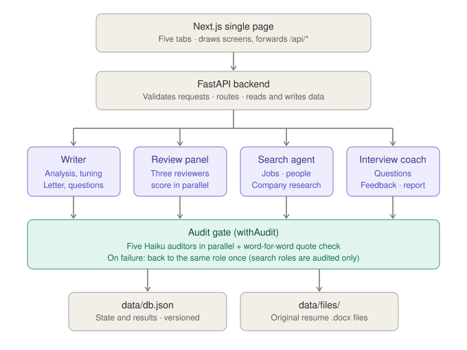
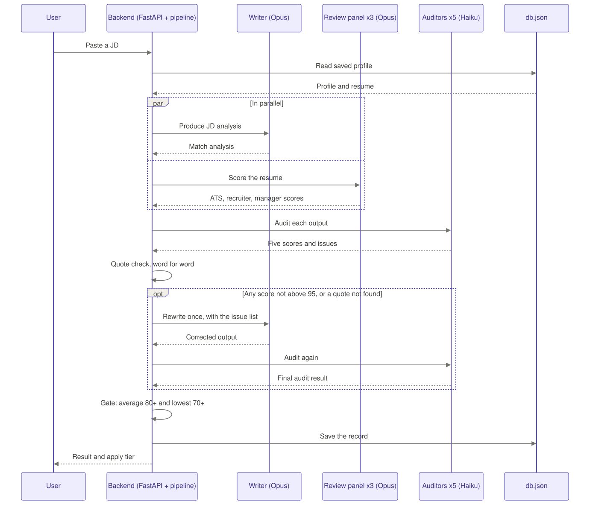
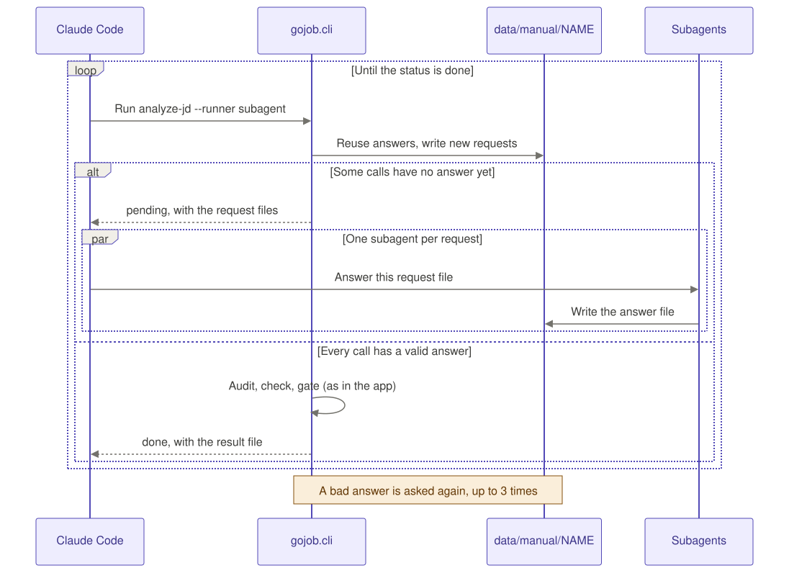

# GoJob architecture

Four diagrams: how the pieces fit, what happens when you paste a job description, how Claude Code subagents can answer instead of the API, and how one job moves between "apply", "tune" and "stop". The images are exported from the sources in [`diagrams/`](diagrams/) (the system diagram is drawn by hand as SVG); see [`diagrams/README.md`](diagrams/README.md) to regenerate them.

## 1. System

- There are two ways in. The Next.js page calls `/api/*`, which Next.js forwards to the Python backend (`next.config.mjs`); the screens never call Claude. The command line (`npm run gojob`) and the `run-gojob` skill call the same task code directly.
- The four AI roles are prompts and call patterns, not separate services. The prompts are plain files in `backend/gojob/skills/`, read on every call, so an edit applies without a restart. The writer, the review panel and the interview coach produce structured answers; the search agent also uses web search.
- `backend/gojob/model_client.py` is the only code that calls a model. By default it calls the Claude API. With `--runner subagent` (command line only) it hands each call to a Claude Code subagent through files instead (diagram 3). The code, not the model runner, decides what to ask and whether the result passes.
- Every AI answer goes through two steps before it is saved. Resume changes first pass a layout lock that drops any change on the name, section title, employer, job title, date, place or school lines. Then the audit gate in `backend/gojob/audit.py` runs five auditors and a word-for-word quote check, and asks the writer to redo the answer once if it fails. Search answers (job scan, company watch, people) are audited but not rewritten, because their facts come from the web, not from your resume.
- All state lives in `data/db.json`; resumes live in `data/files/`, whether uploaded or fetched from a Google Doc link as Word. Subagent runs keep their request and answer files in `data/manual/`, which is private and git-ignored. None of it leaves your machine except what is sent to the model.

## 2. What happens when you paste a JD

- `par`: the match analysis and the reviewer scores are two lanes that run at the same time. Each lane has its own audit and quote check.
- `opt`: the repair pass only happens if a lane fails: an auditor scores 95 or lower, a checklist box is unticked, or a quote is not found word for word in its source. That lane rewrites once and is audited again.
- The gate at the end decides the apply tier: average 80 or more with no reviewer below 70.

Source: [`diagrams/jd-analysis-sequence.mmd`](diagrams/jd-analysis-sequence.mmd)

## 3. Answering without an API key

- The command writes a request file for every model call that has no answer yet, then stops and prints `pending`. Subagents (one per request, in parallel) write the answers. Running the same command again reuses every answer that exists, so the loop repeats until the status is `done`.
- An answer that does not match its schema is set aside and asked again, up to 3 times.
- Once every call has an answer, the audit, quote check and gate are the same code as in the app, so the result means the same thing. It is stamped `runner: subagent`.
- Command line only, and it assesses one job description. Files are written to `data/manual/NAME/`; they hold your resume and the JD, so delete the folder when you are done.

Source: [`diagrams/subagent-replay-sequence.mmd`](diagrams/subagent-replay-sequence.mmd)

## 4. Apply, tune, or stop

- Tuning may only reword what the resume already shows. It cannot add numbers, tools or titles; missing details become `[X%]` placeholders marked `needs_confirmation`.
- That is why tuning has a ceiling. It stops when the latest fine-tune has no change the resume supports, or when a resume change raised the average by less than 1 point (`CEILING_MIN_GAIN` in `scoring.py`). The fine-tune button is then disabled and the backend refuses another one.
- A resume that really lacks the experience cannot be tuned into a pass. The way out is to add real experience and upload the revised resume, or to choose another job.

Source: [`diagrams/fit-and-tuning-states.mmd`](diagrams/fit-and-tuning-states.mmd)
